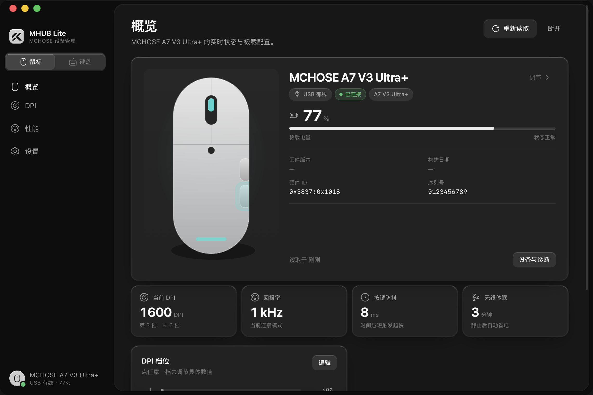
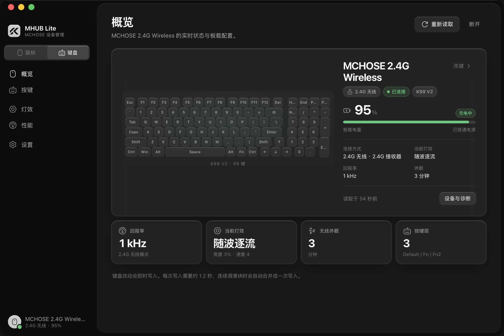
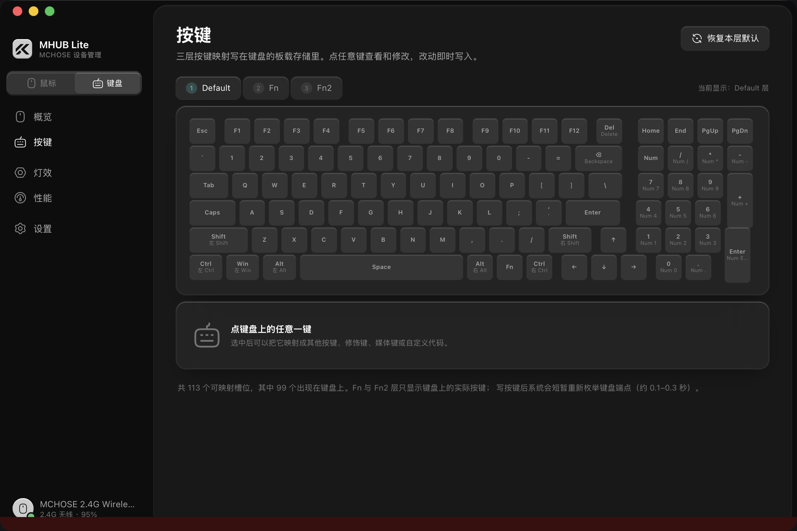
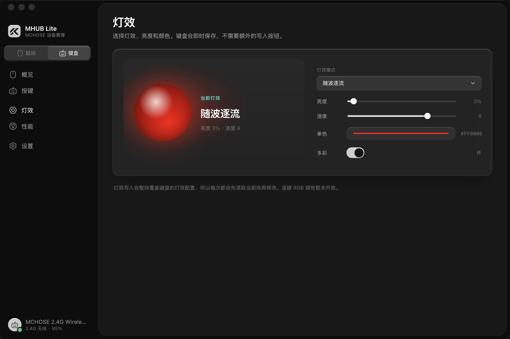
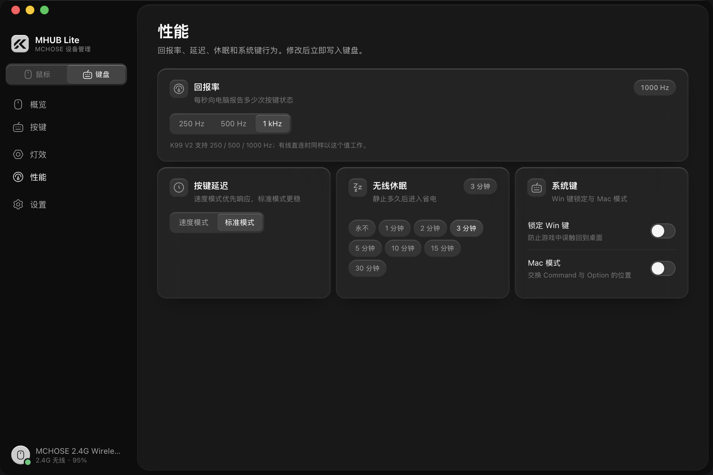
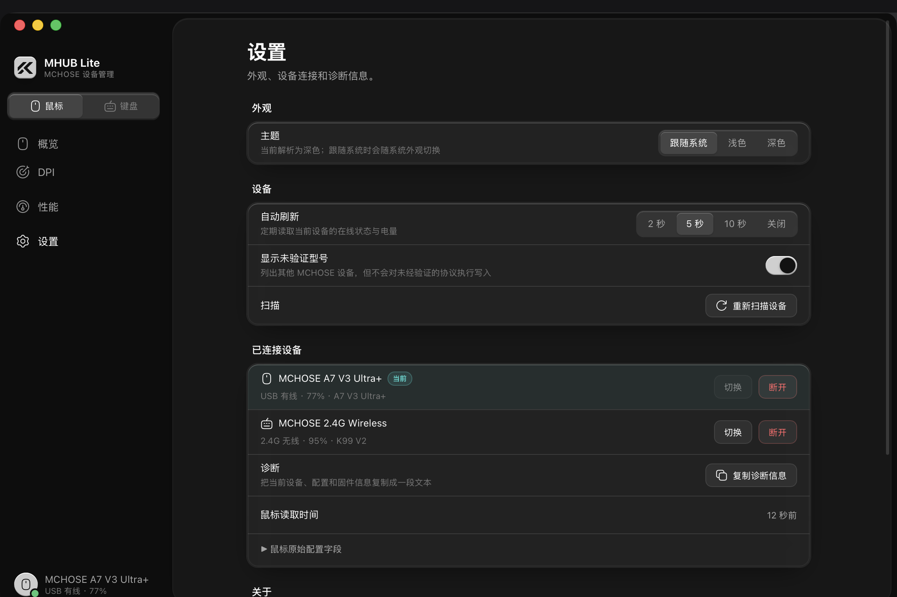
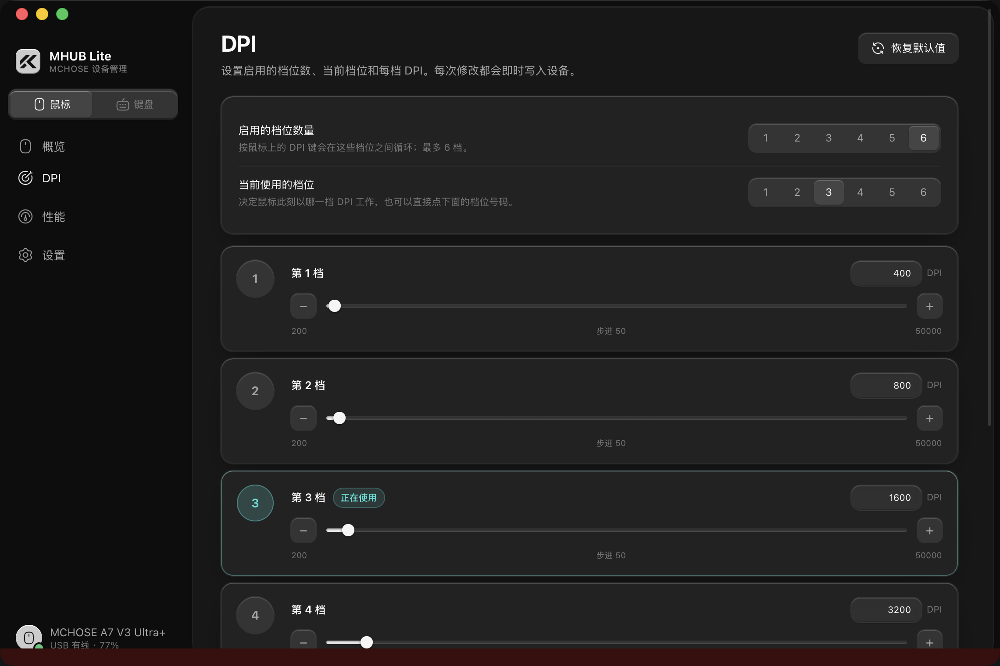

# MHUB Lite

**轻量、离线、跨平台的 MCHOSE 鼠标 + 键盘管理工具。**

直接通过 USB HID / 2.4G 接收器读写设备的板载配置。没有账号、没有云端、没有 Electron —— 一个窗口，几 MB 的原生应用。改动即时写入，不需要再点「应用」。

**[下载最新版本](https://github.com/RedCarl/MHUB-Lite/releases/latest)** · macOS 11+ / Windows 10+



---

## 能做什么

### 鼠标

| | |
|---|---|
| **设备概览** | 电量、充电状态、连接方式、硬件 ID、当前 DPI / 回报率 / 防抖 / 休眠 |
| **DPI** | 启用 1–6 档、切换当前档位、每档 DPI 独立调节 |
| **性能** | 回报率、按键防抖、无线休眠；G3 V2 另有 LOD |

支持两套鼠标协议：

- **MCHOSE G3 V2**（有线 `0x3837:0x418C` / 2.4G `0x4245`）：`0x55` 64 字节帧，DPI、回报率、按键、防抖、休眠、LOD。协议来自 M-RustHub 的实机验证；本机没有 G3 V2 硬件。
- **MCHOSE A7 V3 Ultra+**（`0x3837:0x1018`）：`0x4D` 帧，DPI、回报率、防抖、休眠、电量。本机已实测读取和 DPI 写入；A7 的按键改键与灯光暂未开放。

### 键盘

| | |
|---|---|
| **三层改键** | Default / Fn / Fn2，99 键可视化布局，随意映射按键、修饰键、媒体键或自定义 4 字节代码 |
| **灯效** | 灯效模式、亮度、速度、单色/多彩 |
| **性能** | 250 / 500 / 1000 Hz 回报率、速度/标准延迟、无线休眠、Win 键锁定、Mac 模式 |

目前已验证 **MCHOSE K99 V2 2.4G**（接收器 `0x41E4:0x2001`）：读取型号签名后读写三层键表、灯效块与性能块。修改即刻保存。



---

## 即时保存

没有草稿、没有底部「写入设备」栏，也没有播放器式的悬浮条：

- 改 DPI、回报率、防抖、休眠或按键后，短暂合并（鼠标约 320 ms、键盘约 450 ms）就写入设备；
- 连续拖动滑块会合并成一次写入，不会每移动一像素就擦一次 Flash；
- 写入串行排队，结果会回读确认；
- 侧边栏底部显示「保存中… / 已保存」，失败时在内容区顶部给出明确原因。

键盘的一次完整写入需要约 1.2 秒（固件要求写入间隔），界面会保持可操作，等待期间继续改的值会在上一笔完成后自动接上。

---

## 多设备

鼠标和键盘可以同时连接。侧边栏顶部的「鼠标 / 键盘」开关切换当前设备，导航会随设备类型变化：

- 鼠标：概览、DPI、性能（G3 V2 额外有「按键」）
- 键盘：概览、按键、灯效、性能
- 「设置」不在导航里，而是侧栏底部、设备信息上方的一枚独立按钮

---

## 截图

| 鼠标概览 | 键盘概览 |
|---|---|
|  |  |

| 键盘三层改键 | 键盘灯效 |
|---|---|
|  |  |

| 键盘性能 | 设置与设备切换 |
|---|---|
|  |  |



---

## 支持的硬件

| 型号 | 连接 | 支持 | 说明 |
|---|---|---|---|
| MCHOSE G3 V2 | `0x3837:0x418C` 有线 | 鼠标全功能 | G3 V2 协议 |
| MCHOSE G3 V2 | `0x3837:0x4245` 2.4G | 鼠标全功能 | G3 V2 协议 |
| MCHOSE A7 V3 Ultra+ | `0x3837:0x1018` 有线 | DPI / 性能 / 电量 | `0x4D` 协议；改键与灯光未开放 |
| MCHOSE K99 V2 | `0x41E4:0x2001` 2.4G | 改键 / 灯效 / 性能 | 需匹配 K99 V2 签名 |
| 其他 MCHOSE 型号 | `0x3837:*` / `0x41E4:*` | 只识别 | 未验证协议，不会被写入 |

- A7 V3 Ultra+ 的 LOD 是 0.7–1.7 mm 五档，当前界面只开放 G3 V2 的 1/2 mm 模型，所以 A7 页面暂不显示 LOD。
- K99 V2 的宏、逐键 RGB 调色、音乐律动暂未实现。
- 未验证型号会被列出但拒绝打开写入，避免把未知设备写坏。
- **本机实测范围**：A7 V3 Ultra+ 的读取与 DPI 写入、K99 V2 2.4G 的键层写入。K99 的灯效/性能块与 A7 的设置块走同一条已验证的传输通道，但尚未逐项做硬件回归。

---

## 连接提示

### 键盘被占用

MCHOSE 网页驱动、MCHOSE HUB 或浏览器里的 WebHID 会独占接收器。MHUB Lite 连接失败时会提示：

> 设备被其他程序独占：请关闭 MCHOSE HUB、浏览器里的 MCHOSE 网页驱动或其他占用 HID 的程序后重试。

关闭这些程序后重新扫描即可。

### macOS

- macOS 11+；安装包没有公证，首次打开若提示「已损坏」，在 Finder 右键 → 打开。
- 若系统询问「输入监控 / Input Monitoring」，允许后重新打开应用；hidapi 需要它访问厂商 HID 接口。

### Windows

- Windows 10 / 11，需要 WebView2（系统一般已自带）。
- 安装包没有代码签名，SmartScreen 提示「未知发布者」时选择「仍要运行」。

### Linux

构建依赖：

```bash
sudo apt install libudev-dev pkg-config    # Debian / Ubuntu
sudo dnf install libudev-devel pkgconf     # Fedora
```

给两组 VID 开放 hidraw 权限：

```bash
sudo tee /etc/udev/rules.d/70-mchose.rules >/dev/null <<'EOF'
SUBSYSTEM=="hidraw", ATTRS{idVendor}=="3837", MODE="0660", TAG+="uaccess"
SUBSYSTEM=="hidraw", ATTRS{idVendor}=="41e4", MODE="0660", TAG+="uaccess"
EOF
sudo udevadm control --reload-rules
sudo udevadm trigger
```

重新插拔设备后生效。

---

## 安装与运行

### 直接下载

到 [GitHub Releases](https://github.com/RedCarl/MHUB-Lite/releases/latest) 下载：

- Windows：`MHUB Lite_<版本>_x64-setup.exe`，或 `.msi`
- macOS：`MHUB Lite_<版本>_aarch64.dmg`（Apple 芯片）/ `_x64.dmg`（Intel）

安装包没有开发者证书：macOS 首次打开若提示「已损坏」，在 Finder 里右键 → 打开；Windows SmartScreen 提示「未知发布者」时选择「仍要运行」。

### 从源码构建

需要 **Node.js 20+、pnpm、Rust stable**。

```bash
pnpm install
pnpm tauri dev      # 开发（窗口 + 热更新）
pnpm tauri build    # 打包当前平台的安装包
```

### 发布

推送 `v*` tag 会触发 GitHub Actions 的 `release` 工作流：在 macOS arm64、macOS x64 和 Windows x64 上分别构建，并把安装包上传到对应的 GitHub Release。

```bash
git tag v0.1.0
git push origin v0.1.0
```


协议测试不需要窗口或外设：

```bash
cargo test -p mhub-core
```

前端类型检查与构建：

```bash
pnpm check
pnpm build
```

---

## 技术栈

- **外壳**：Tauri 2（macOS Overlay 标题栏 / Windows 自绘标题栏 / Linux 原生窗口）
- **界面**：Svelte 5（runes）+ TypeScript + Vite 6
- **协议层**：Rust，hidapi 直接收发 HID 报文；鼠标与键盘用独立模块，互不影响
- **图标**：Hugeicons（Stroke Rounded 免费集）
- **材质**：Solid Glass（移植到普通 CSS，无 Tailwind / shadcn）
- **体积**：release 开启 `opt-level=z`、LTO、strip；macOS arm64 `.app` 约 2.7 MB

```
MHUB-Lite/
├── core/
│   └── src/
│       ├── protocol.rs   # G3 V2 0x55 帧
│       ├── device.rs     # G3 V2 设备与重试
│       ├── a7.rs         # A7 V3 Ultra+ 0x4D 帧
│       ├── keyboard.rs   # K99 V2 2.4G 0x13 包与三层键表
│       ├── mouse.rs      # 鼠标后端枚举
│       ├── transport.rs  # hidapi 传输
│       └── catalog.rs    # 已验证型号
├── src-tauri/            # Tauri 命令、双设备会话、单实例
├── src/
│   ├── app.css           # Solid Glass 设计系统
│   ├── lib/              # api / device / keyboard 布局 / router / theme
│   ├── components/       # 窗口、Logo、键盘矩阵、鼠标预览、控件
│   └── routes/           # 鼠标与键盘页面
├── docs/
│   ├── protocol.md       # G3 / A7 / K99 协议
│   └── design.md         # 材质、布局与即时保存交互
└── screenshots/
```

---

## 设计

概览页使用 MCHOSE 官方产品渲染图（A7 V3 Ultra+ / K99 V2 / G3 V2）；界面沿用 TinyMusic 的 Solid Glass 材质和外壳规则：212px 侧边栏、内缩 8px 的圆角内容玻璃、侧栏选中块滑动指示、深/浅两套令牌、减少透明与减少动效的退路。

设备工具在此基础上做了适配：

1. **设备切换**：侧边栏顶部用一小块分段玻璃在鼠标 / 键盘之间切换，导航随设备类型变化。
2. **即时保存**：没有播放器式底栏；保存状态放在侧栏设备脚注里，内容区只在失败时出现提示条。
3. **键盘矩阵**：99 键的可视化布局，Default/Fn/Fn2 三层切换，点键后在下方检查器里改映射。
4. **鼠标预览**：按键页和概览共用同一只 SVG 鼠标，悬停行时对应区域亮起。

细节见 [`docs/design.md`](docs/design.md)。

---

## 安全与边界

- **只写已验证协议**：未知型号只识别，不打开写入。
- **写入前校验**：DPI 范围/步进、档位数、回报率、防抖、休眠在 Rust 侧再次校验。
- **先读再改**：键盘的灯效块和三层层键表都是整块覆盖，必须先读回、只改目标字段、再写。
- **读回确认**：每次写入后回读目标块；不一致时报错，不静默重试整套配置。
- **保留未知字段**：G3 / A7 / K99 的保留槽都会原样读回、原样写回。
- **完全离线**：没有网络请求、没有账号、没有遥测。
- **单实例**：第二个实例只会聚焦已有窗口，避免两个窗口同时写同一台设备。

> 本项目是非官方工具，与 MCHOSE 没有隶属关系。HID 写入属于底层操作，请确认设备型号；使用风险自负。

---

## 开发约定

- 提交信息用英文 Conventional Commits，例如 `feat(keyboard): add layer editor`。
- 用户可见文案用中文；协议注释与诊断信息可以中英混排，但错误码保持英文。
- 新增型号：在 `catalog.rs` / `a7.rs` / `keyboard.rs` 中加 profile 与能力表，补协议测试；**没有实机验证前不要打开写入**。
- 提交前跑：`cargo test -p mhub-core && cargo clippy -p mhub-core --all-targets -- -D warnings && pnpm check && pnpm build`。

---

## 致谢

- [M-RustHub](https://github.com/hadoooooouken/M-RustHub)：G3 V2 的 HID 协议、帧布局与按键槽位。
- [mchose-hub-rust](https://github.com/mansur54321/mchose-hub-rust)：A7 V3 Ultra+ / MagDock 的 0x4D 协议与 macOS 传输方式。
- [MchoseHub](https://github.com/wzk112/MchoseHub)：K99 V2 的无线分包、三层键表、灯效与性能块布局，以及键盘物理布局。
- [mchose-linux](https://github.com/aipno/mchose-linux)：K99 V2 有线协议与键名表。
- [TinyMusic](https://github.com/RedCarl/TinyMusic)：Tauri + Svelte 技术栈、窗口外壳、Solid Glass 材质与交互规则。
- [solid-glass](https://github.com/deeplethe/solid-glass)：材质语言。
- [Hugeicons](https://hugeicons.com/)：图标。

产品渲染图（A7 V3 Ultra+ / K99 V2 / G3 V2）来自 MCHOSE 官方网页驱动的 configCenter
资源，仅用于识别已连接的设备；MCHOSE 名称、商标与图片版权归迈从科技所有。
详见 [NOTICE](NOTICE)。

## 许可

[MIT](LICENSE)
