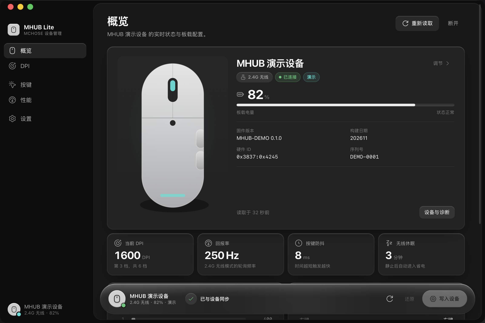
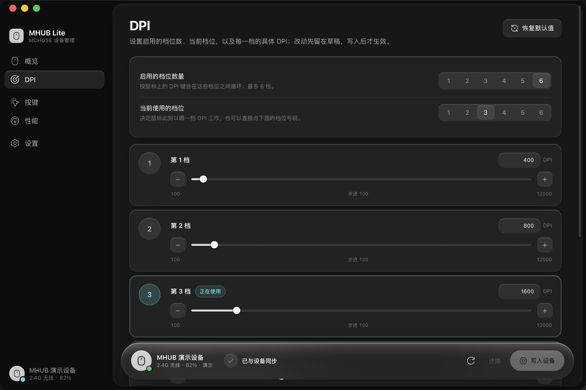
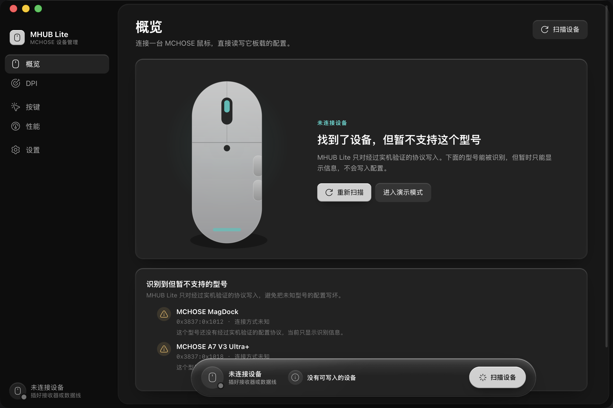
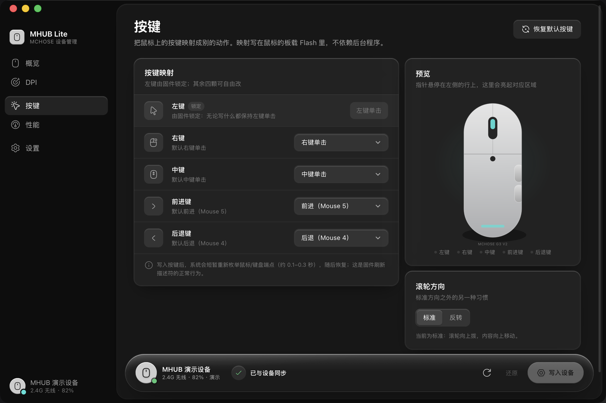
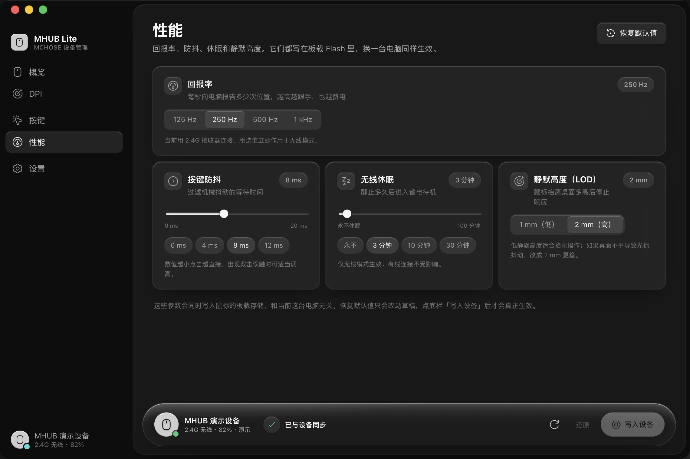
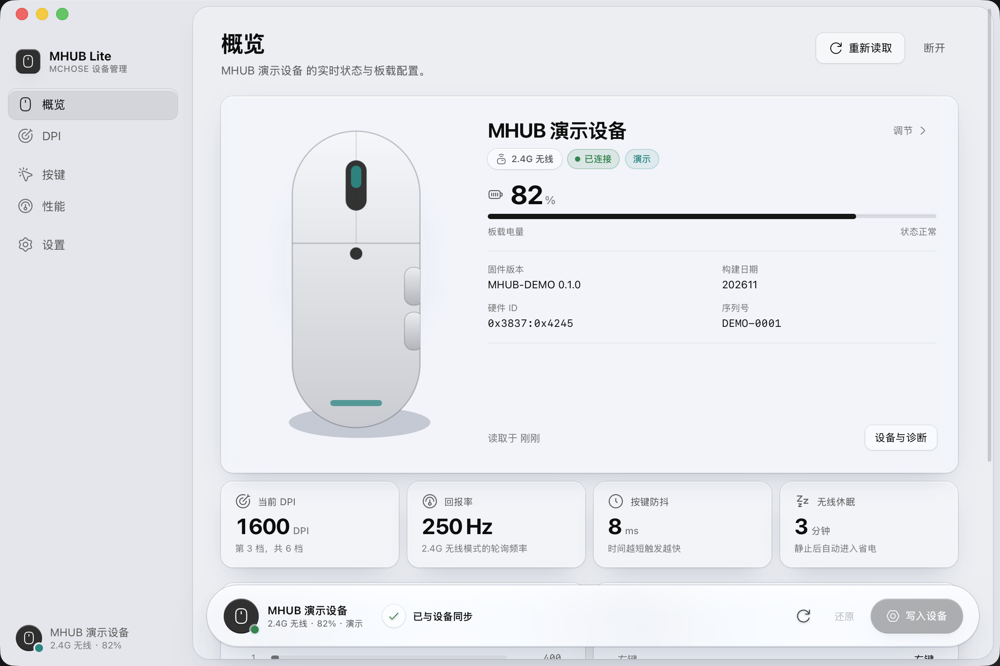

# MHUB Lite

**轻量、离线、跨平台的 MCHOSE 设备管理工具。**

直接通过 USB HID 读写鼠标的板载配置：DPI 档位、回报率、按键映射、防抖、休眠和静默高度。没有账号、没有云端、没有 Electron —— 一个窗口，几 MB 级的原生应用。

协议与功能参考 **[M-RustHub](https://github.com/hadoooooouken/M-RustHub)**；技术栈、页面布局与交互规则照搬 **[TinyMusic](https://github.com/RedCarl/TinyMusic)**：Tauri 2 + Svelte 5 + Rust，界面使用 Solid Glass 材质。



---

## 能做什么

| | |
|---|---|
| **设备概览** | 电量与充电状态、固件版本、连接方式、硬件 ID、休眠状态 |
| **DPI** | 启用 1–6 档、切换当前档位、每一档 100–12000 DPI（步进 100） |
| **按键** | 右键 / 中键 / 前进 / 后退改键、左键固件锁定、滚轮方向 |
| **性能** | 回报率 125–1000 Hz、防抖 0–20 ms、无线休眠 0–100 分钟、LOD 1/2 mm |
| **写入方式** | 先改草稿，确认后一次性写入板载 Flash；写入后换电脑也保留 |
| **安全边界** | 只对经过实机验证的型号写入；其他 MCHOSE 设备只识别、不写入 |
| **演示模式** | 没有硬件也能完整走一遍读取 → 修改 → 写入流程 |

配置直接写进鼠标的板载存储，不依赖后台常驻程序。改完按键后，系统会短暂重新枚举 HID 端点（约 0.1–0.3 秒），这是固件刷新描述符的正常行为。



---

## 支持的硬件

目前只对 **MCHOSE G3 V2** 开放写入，协议来自 M-RustHub 的实机验证与本项目的帧级测试。

| 型号 | VID:PID | 连接 | 状态 |
|---|---|---|---|
| MCHOSE G3 V2 | `0x3837:0x418C` | USB 有线 | 支持读写 |
| MCHOSE G3 V2 | `0x3837:0x4245` | 2.4G 接收器 | 支持读写 |
| 其他 MCHOSE 设备 | `0x3837:*` | — | 会被识别并列出，但**不会写入** |

> 在开发机上实测识别到了 `MCHOSE MagDock (0x1012)` 和 `MCHOSE A7 V3 Ultra+ (0x1018)`。它们没有验证过的协议，MHUB Lite 只显示识别信息，避免把未知型号写坏。新增型号的方法见 [`docs/protocol.md`](docs/protocol.md)。



鼠标休眠时接收器仍在线，但配置不可读、不可写。界面会提示先移动鼠标唤醒，再重新读取。

---

## 截图

| 概览 | DPI |
|---|---|
|  |  |

| 按键 | 性能 |
|---|---|
|  |  |


浅色主题是同一套玻璃在天光下的形态：



---

## 安装与运行

需要 **Node.js 20+、pnpm、Rust stable**。

```bash
pnpm install
pnpm tauri dev      # 开发（窗口 + 热更新）
pnpm tauri build    # 打包当前平台的安装包
```

没有设备时可以用演示模式：

```bash
MHUB_DEMO=1 pnpm tauri dev
# 或在「设置 → 演示模式」里打开
```

只跑协议测试（不需要窗口、不需要外设）：

```bash
cargo test -p mhub-core
```

前端类型检查与构建：

```bash
pnpm check
pnpm build
```

### macOS

- 系统要求 macOS 11+；Apple 芯片与 Intel 都支持。
- 安装包**没有做 Apple 公证**。首次打开若提示「已损坏」或「无法验证开发者」，在 Finder 里右键 → 打开。
- 如果系统询问「输入监控 / Input Monitoring」，允许后重新打开应用；hidapi 需要它来访问厂商 HID 接口。

### Windows

- Windows 10 / 11，需要 WebView2（系统一般已自带）。
- 安装包没有代码签名，SmartScreen 提示「未知发布者」时选择「仍要运行」。

### Linux

hidapi 使用 hidraw 后端，构建时需要 `libudev`：

```bash
sudo apt install libudev-dev pkg-config    # Debian / Ubuntu
sudo dnf install libudev-devel pkgconf     # Fedora
```

运行时给当前用户开放 MCHOSE 设备的 hidraw 权限：

```bash
sudo tee /etc/udev/rules.d/70-mchose.rules >/dev/null <<'EOF'
SUBSYSTEM=="hidraw", ATTRS{idVendor}=="3837", MODE="0660", TAG+="uaccess"
EOF
sudo udevadm control --reload-rules
sudo udevadm trigger
```

重新插拔设备后生效。

---

## 技术栈

- **外壳**：Tauri 2（macOS Overlay 标题栏 / Windows 自绘标题栏 / Linux 原生窗口）
- **界面**：Svelte 5（runes）+ TypeScript + Vite 6
- **协议层**：Rust `mhub-core`，hidapi 直接收发 64 字节 HID 包
- **图标**：Hugeicons（Stroke Rounded 免费集）
- **材质**：Solid Glass（移植到普通 CSS，无 Tailwind / shadcn）
- **体积**：release 开启 `opt-level=z`、LTO、strip；macOS arm64 的 `.app` 约 2.7 MB

```
MHUB-Lite/
├── core/                 # mhub-core：协议、设备模型、真实/演示 Transport
│   └── src/
│       ├── protocol.rs   # 帧编解码（纯函数 + 测试）
│       ├── device.rs     # 打开设备、重试、读写、能力校验
│       ├── transport.rs  # hidapi 实现
│       ├── demo.rs       # 按同一帧格式应答的内存设备
│       └── catalog.rs    # 已验证型号与能力表
├── src-tauri/            # Tauri 外壳：命令、状态、窗口
├── src/                  # Svelte 前端（App + 5 个页面 + 共享组件）
│   ├── app.css           # Solid Glass 设计系统
│   ├── lib/              # api / device store / router / theme / prefs
│   ├── components/       # 标题栏、窗口按钮、底栏、鼠标预览、控件
│   └── routes/           # overview / dpi / buttons / performance / settings
├── docs/
│   ├── protocol.md       # HID 协议、帧布局、安全规则、扩展型号
│   └── design.md         # 材质、布局与交互规则
└── screenshots/
```

---

## 设计

界面完整沿用 TinyMusic 的 Solid Glass 材质和外壳规则：212px 侧边栏、内缩 8px 的圆角内容玻璃、侧栏选中块滑动指示、右侧内容区与底部液态玻璃栏、深/浅两套令牌、减少透明与减少动效的退路。

设备工具在此基础上做了三处适配：

1. **底部播放器栏 → 设备栏**：常驻显示当前设备、电量、同步状态，并承载「还原 / 写入设备」两个动作。全站仍然只有这一处液态玻璃。
2. **歌曲行 → 参数行**：DPI 档位、按键映射、性能参数都按「一行一个可编辑对象」排布，改动先进入草稿，底栏显示「N 项未写入」。
3. **鼠标预览**：按键页和概览用同一只 SVG 鼠标，悬停左侧行时对应按键区域会亮起，点击可把注意力带回当前对象。

细节见 [`docs/design.md`](docs/design.md)。

---

## 安全与边界

- **只写已验证协议**：未知 MCHOSE 型号不会被打开写入；打开已知型号时还会再校验 VID/PID 与配置接口。
- **写入前校验**：DPI 范围/步进、档位数、回报率、防抖、休眠都会在 Rust 侧再校验一次，不信任前端传来的值。
- **写入前唤醒检查**：无线鼠标休眠时直接拒绝写入，而不是写一半超时。
- **固定帧长度**：64 字节，写 HID 时补 `Report ID 0x00`；回应必须匹配 `0xAA + 命令号`。
- **保留未知字段**：`sensorFlags` / `highspeedMode` / `sensorAngle` 等界面没开放的字段会原样读出、原样写回，避免一次保存把它们清零。
- **完全离线**：没有网络请求、没有账号、没有遥测。演示模式的数据只在内存里。
- **不做的事**：不改灯光、不做宏、不做固件升级、不做 per-app 配置、不做云同步 —— 这些官方软件里有，但当前公开协议没有覆盖。

> 本项目是非官方工具，与 MCHOSE 没有隶属关系。HID 写入属于底层操作，请先确认型号；使用风险自负。

---

## 开发约定

- 提交信息用英文 Conventional Commits，例如 `feat(dpi): add stage count selector`。
- 用户可见文案用中文；协议注释与诊断信息可以中英混排，但错误码保持英文。
- 新增型号：在 `core/src/catalog.rs` 里加 profile 与能力表，补协议测试；**没有实机验证前不要打开写入**。
- 提交前跑：`cargo test -p mhub-core && cargo clippy -p mhub-core --all-targets -- -D warnings && pnpm check && pnpm build`。

---

## 致谢

- [M-RustHub](https://github.com/hadoooooouken/M-RustHub)：G3 V2 的 HID 协议、帧布局与按键槽位映射。
- [TinyMusic](https://github.com/RedCarl/TinyMusic)：Tauri + Svelte 技术栈、窗口外壳、Solid Glass 材质与交互规则。
- [solid-glass](https://github.com/deeplethe/solid-glass)：Solid Glass 的原始材质语言。
- [Hugeicons](https://hugeicons.com/)：图标。
- [Tauri](https://tauri.app/) 与 [Svelte](https://svelte.dev/)：应用外壳与界面运行时。

## 许可

[MIT](LICENSE)
