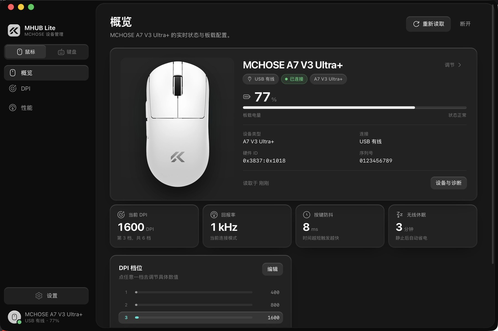

# MHUB Lite

一个几 MB 的 MCHOSE 鼠标 / 键盘管理工具。DPI、改键、灯效、回报率，都在一个窗口里。

**[官网与下载](https://redcarl.github.io/MHUB-Lite/)** · **[源码](https://github.com/RedCarl/MHUB-Lite)** · **[问题反馈](https://github.com/RedCarl/MHUB-Lite/issues)**



---

## 这是什么

MHUB Lite 是一个 Windows / macOS 上的 MCHOSE 设备工具。插上鼠标或 2.4G 接收器，就能查看电量、调 DPI、改按键、换灯效，改动会直接写进设备的板载存储。

它不登录账号、不上传配置，也没有云端同步。界面只做一件事：把设备当前的真实状态摆出来，让你改完就能走。

---

## 能做什么

### 鼠标

- 概览：电量、充电状态、连接方式、当前 DPI / 回报率 / 防抖 / 休眠
- DPI：启用 1–6 档、切换当前档位、每档单独调节
- 性能：回报率、按键防抖、无线休眠
- 支持 G3 V2 和 A7 V3 Ultra+；A7 暂未开放改键与灯效

### 键盘

- 三层改键：Default / Fn / Fn2，99 键可视化布局
- 把任意键映射成其他按键、修饰键、媒体键或自定义代码
- 灯效：模式、亮度、速度、单色 / 多彩
- 性能：250 / 500 / 1000 Hz 回报率、按键延迟、无线休眠、Win 键锁定、Mac 模式
- 目前支持 K99 V2 2.4G

### 即时保存

没有「草稿 → 应用」两步。改完稍等一两秒就写入设备，侧边栏会显示「保存中… / 已保存」；连续拖滑块会合并成一次写入，不会反复擦写。

### 多设备

鼠标和键盘可以同时连接。侧边栏顶部切换当前设备，导航会跟着变；设置固定在侧边栏底部，不占导航。

### 后台常驻与低电量提醒

- 关闭窗口只是隐藏到托盘（Windows）或菜单栏（macOS），电量监测继续在后台运行
- 默认每 1 分钟读一次鼠标和键盘的电量，低于 20% 时发系统通知；阈值可选 10% / 20% / 30%
- 充电时不会提醒；同一轮放电只提醒一次，充电或电量回升后重新计数
- 可以设置登录时自动启动，启动后窗口默认隐藏
- 托盘菜单里能看当前电量、开关低电量提醒 / 开机自启，或者彻底退出应用

设置入口：**设置 → 后台与电量**。

### 其他

- 跟随系统的浅色 / 深色主题，也可以手动指定
- 应用内检查更新，发现新版本时设置按钮出现小圆点
- Windows / macOS 双平台，离线可用
- 不登录、不联网也能管理设备

---

## 下载与安装

安装包都在这一个页面：**<https://redcarl.github.io/MHUB-Lite/>**

下载默认走镜像加速，页面底部可以切换成 GitHub 直连。

| 平台 | 要求 |
|---|---|
| Windows | Windows 10 / 11，64 位 |
| macOS | macOS 11 及以上，Apple 芯片或 Intel |

- 安装包约 3–4 MB，新版本可在「设置 → 软件更新」里检查
- macOS 首次打开若提示「已损坏」，在 Finder 里右键选择「打开」即可（安装包没有做 Apple 公证）
- **macOS 键盘需要「输入监控」权限**：系统设置 → 隐私与安全性 → 输入监控，允许 MHUB Lite 后重启应用
- Windows 安装包没有代码签名，SmartScreen 若提示「未知发布者」，选择「仍要运行」
- 历史版本都在 [GitHub Releases](https://github.com/RedCarl/MHUB-Lite/releases)

---

## 常见问题

**支持哪些设备？**

鼠标：MCHOSE G3 V2、A7 V3 Ultra+。键盘：K99 V2 2.4G。其他型号会被识别出来，但暂时只读，不会写入。

**为什么 A7 不能改键、调灯效？**

这两块协议还没有完全验证。MHUB Lite 只对确认过的写入开放，宁可先不做，也不拿设备冒险。

**键盘连不上？**

先关掉 MCHOSE HUB、浏览器里的 MCHOSE 网页驱动，以及其他占用 HID 的程序。macOS 还需要在「输入监控」里允许 MHUB Lite。

**关掉窗口后应用还在运行吗？**

默认是。关闭窗口只是隐藏到托盘 / 菜单栏，后台电量监测继续。要完全退出，用托盘菜单的「退出 MHUB Lite」，或在「设置 → 关于」里点「退出 MHUB Lite」。如果不需要后台常驻，把「设置 → 后台与电量 → 后台常驻」关掉，之后关闭窗口就会退出应用。

**低电量提醒怎么设置？**

在「设置 → 后台与电量」里打开「电量监测」和「低电量提醒」，选择提醒阈值和检查间隔。第一次发通知时系统会请求通知权限；如果没看到提醒，检查系统设置里是否允许 MHUB Lite 发送通知。充电时不会提醒，同一轮放电只提醒一次。

**会写坏设备吗？**

只对已验证的型号写入；写入前会校验范围，写完会回读确认。没有验证的型号只显示信息。

**需要联网吗？**

管理设备完全离线。只有检查更新和下载新版本需要网络，没有账号、没有遥测。

**我的配置存在哪？**

配置写在设备自己的板载存储里，换电脑也还在。应用不上传任何设备数据。

**为什么 macOS 提示没有权限？**

键盘的 HID 访问需要「输入监控」权限。允许 MHUB Lite 后重启应用即可；鼠标不受影响。

---

## 免责声明

- 本项目是**非官方**工具，与 MCHOSE（迈从科技）没有隶属关系，也不代表它们。
- 只读写经过验证的设备协议；不包含、不分发官方客户端程序。
- MCHOSE 名称、商标与产品图片版权归迈从科技所有。产品图片仅用于识别设备。
- 设备写入属于底层操作，请确认型号后使用；使用风险自负。

---

## 更多

- 源码与问题反馈：<https://github.com/RedCarl/MHUB-Lite>
- 如果它好用，欢迎点个 Star。
- 给开发者看的技术细节在 [`docs/`](docs/)：协议笔记、界面与交互说明。

<details>
<summary>开发与构建</summary>

```bash
pnpm install
pnpm tauri dev          # 开发
pnpm tauri build        # 打包

cargo test -p mhub-core # 协议层测试，不需要窗口或外设
```

需要 Node.js、pnpm 和 Rust 工具链。

开发模式下系统通知可能不稳定：macOS 会把通知归到「终端」并弹一次权限请求，Windows 在未安装的 `target\debug` 目录下也可能不显示 toast。要验证低电量提醒，请用打包后的安装版。

</details>
